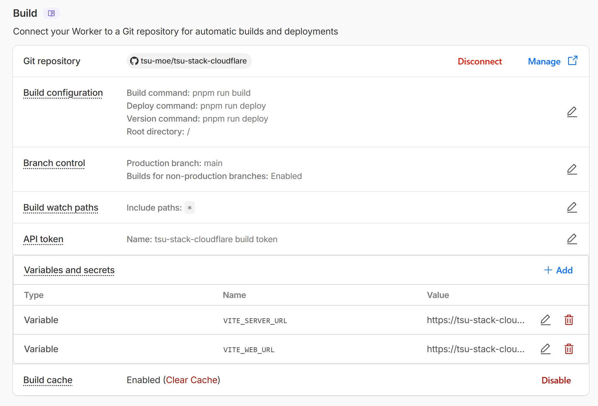
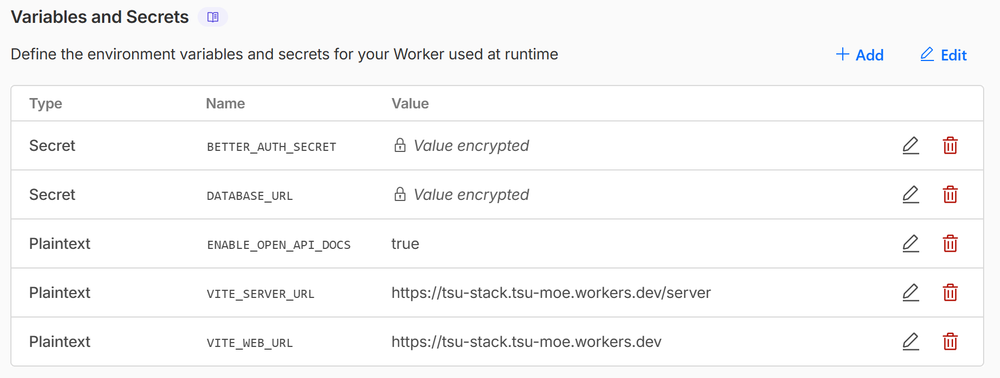

<h1 align="center">
    <br>
    <a href="https://tsu-stack.tsu.moe/">tsu!stack</a>
</h1>

<p align="center">
   
   
   
   
   
   
   
   
</p>

<p align="center">
  Node.js 24 and pnpm TanStack Start monorepo featuring shadcn/ui, Paraglide.js (i18n), Hono, oRPC, drizzle-orm, Clerk, Feature-Sliced Design (FSD), and more. 🐋 Dockerized and opinionated. Other runtimes, including ⛅ Cloudflare Workers, require their corresponding deployment adapter.
</p>

<p align="center">
  
</p>

<p align="center">
  <strong>✨ Live Demo Deployments ✨</strong><br />
  <a href="http://tsu-stack.tsu.moe" target="_blank">Dockerfile (Coolify)</a><br>
  <a href="http://tsu-stack-coolify.tsu.moe" target="_blank">Docker Compose (Coolify)</a><br>
  <a href="http://tsu-stack-merged.tsu.moe" target="_blank">Merged Web + Server with Dockerfile (Coolify)</a> | <a href="https://github.com/tsu-moe/tsu-stack/tree/variant/merged" target="_blank">see branch</a><br>
  <a href="https://tsu-stack.tsu-moe.workers.dev" target="_blank">Merged Web + Server (Cloudflare Workers)</a> | <a href="https://github.com/tsu-moe/tsu-stack/tree/variant/merged-cloudflare" target="_blank">see branch</a>
</p>

## Table of Contents

- [Tech Stack](#tech-stack)
- [Getting Started](#getting-started)
  - [Prerequisites](#prerequisites)
  - [Setup](#setup)
  - [Running with Docker Locally](#running-with-docker-locally)
- [Deployment](#deployment)
  - [Coolify](#coolify)
    - [Option 1: Separate Dockerfiles](#option-1-separate-dockerfiles)
      - [Server Deployment](#server-deployment)
      - [Web Deployment](#web-deployment)
    - [Option 2: Docker Compose](#option-2-docker-compose)
  - [Cloudflare Workers](#cloudflare-workers)
    - [Git-based CI/CD](#git-based-cicd)
  - [Deploying to Other Platforms](#deploying-to-other-platforms)
- [Environment Variables](#environment-variables)
  - [Database Tools](#database-tools)
  - [Server](#server)
  - [Web](#web)
  - [Native](#native)
  - [Extension](#extension)
- [Merging Server to Web App](#merging-server-to-web-app)
  - [Resource Usage](#resource-usage)
- [Issue Watchlist](#issue-watchlist)
  - [Pitfalls](#pitfalls)
- [Contributing](#contributing)
- [Acknowledgements](#acknowledgements)
- [License](#license)

## Tech Stack

Here is a non-exhaustive list of the main technologies used in this project, along with their purposes and possible alternatives they replace:

| Technology                                        | Purpose                                                                                                                                      | Replaces/Similar Alternatives      |
| ------------------------------------------------- | -------------------------------------------------------------------------------------------------------------------------------------------- | ---------------------------------- |
| [**Node.js 24 LTS**](https://nodejs.org/)         | Development and production JavaScript runtime.                                                                                               | Bun, Deno                          |
| [**pnpm**](https://pnpm.io/)                      | Package manager, workspace task runner, one-off CLI runner, and project Node.js runtime manager.                                             | npm, yarn, npx                     |
| [**Vite**](https://vite.dev/)                     | Development server and production builder for the Web app.                                                                                   | webpack, Rspack                    |
| [**Vitest**](https://vitest.dev/)                 | Unit test runner.                                                                                                                            | Jest                               |
| [**Oxfmt / Oxlint**](https://oxc.rs/)             | Formatting and linting.                                                                                                                      | Prettier, ESLint                   |
| [**TanStack Start**](https://tanstack.com/router) | Modern full-stack React framework with SSR, prerendering, and integrated TanStack Query. Vite builds the app, and Hono serves it on Node.js. | Next.js, Remix, React Router       |
| [**Paraglide.js**](https://paraglide.dev/)        | Compiled internationalization (i18n) library for managing translations.                                                                      | i18next, next-intl                 |
| [**Hono**](https://hono.dev/)                     | Lightweight web server framework built on web standards and WinterCG-compliant for cross-platform portability.                               | Express.js, Fastify, Elysia.js     |
| [**oRPC**](https://orpc.dev/)                     | RPC framework to define API routes and generate OpenAPI specs and documentation with [Scalar](https://scalar.com/).                          | tRPC                               |
| [**Drizzle ORM**](https://orm.drizzle.team/)      | Type-safe and lightweight ORM for database interactions.                                                                                     | Prisma, TypeORM                    |
| [**PostgreSQL**](https://www.postgresql.org/)     | Stable open-source relational database.                                                                                                      | MySQL, MariaDB                     |
| [**Clerk**](https://clerk.com/)                   | Authentication and session management shared by Web, Native, Extension, and the API.                                                         | Managed authentication             |
| [**Docker**](https://www.docker.com/)             | Containerization for local development and deployment.                                                                                       | Podman                             |
| [**shadcn/ui**](https://ui.shadcn.com/)           | Accessible and customizable React component library.                                                                                         | Chakra UI, Material UI, Mantine UI |

## Getting Started

### Prerequisites

- **Node.js 22 or newer** to launch pnpm
  - pnpm installs and uses the project's pinned Node.js 24.21.0 runtime
- **pnpm 11.28.2**
  - install with `corepack enable && corepack install --global pnpm@11.28.2`
- **Docker**
  - install it via their [official website](https://www.docker.com/)

### Setup

1. **Clone the repository and install dependencies:**

   ```bash
   pnpm dlx tiged https://github.com/tsu-moe/tsu-stack#main my-tsu-stack-app
   # Available branch specifiers: `main` | `variant/merged` | `variant/merged-cloudflare`

   cd my-tsu-stack-app
   pnpm install --frozen-lockfile
   ```

2. **Copy the environment files:**

   ```bash
   cp packages/env/.env.example packages/env/.env
   ```

3. **Configure Clerk** in `packages/env/.env`:

   Set `CLERK_SECRET_KEY` and `VITE_CLERK_PUBLISHABLE_KEY` for your Clerk application. Configure its allowed origins and sign-in/sign-up URLs to match `VITE_WEB_URL`, including any deployment subpath. See the [authentication guide](../.agents/auth.md) for the Web, Native, and Extension flows.

4. **Start the local PostgreSQL database:**

   ```bash
   pnpm run db:dev:start
   # you can stop it later with pnpm run db:dev:stop
   ```

5. **Migrate the database**:

   ```bash
   pnpm run db:migrate
   ```

6. **Start all development servers:**

   ```bash
   pnpm run dev
   ```

   The following applications will be running:
   - **Web App**: `http://localhost:3000/web`
   - **Server**: `http://localhost:5000/server`
   - **Native App**: Expo dev server
   - **Browser Extension**: WXT dev server

> [!TIP]
> Run `pnpm run fix` to apply formatting and lint fixes, then type-check your code. The tracked pre-commit hook runs the read-only `pnpm run check` command.

### Running with Docker Locally

As an alternative to `pnpm run dev`, you can run the full stack inside Docker using the local compose file:

```bash
cp .env.docker.example .env.docker # And set environment variables as needed
pnpm run docker:up
pnpm run docker:up:build # OR: force a rebuild when you make changes to the code
```

## Deployment

This project is designed to be deployed as separate applications for the server and web frontend. Below are the recommended deployment strategies and configurations.

The Web app uses TanStack Start's Vite build, which outputs static assets and prerendered pages to `apps/web/dist/client` and the request handler to `apps/web/dist/server/server.js`. Node.js 24 runs `apps/web/server.ts` directly: Hono serves existing static files for GET/HEAD requests, then forwards other requests to the Start handler. Sign-in and account creation stay dynamic so their session guards run on every request. Start still provides prerendering and `vite preview`.

To build and run the Web app locally:

```bash
pnpm --filter @tsu-stack/web run build
pnpm --filter @tsu-stack/web run start
```

The Web Dockerfile packages the build and its production dependencies with `pnpm --filter @tsu-stack/web deploy --prod --legacy /prod/web`, copies that directory to `/app`, and starts `node /app/server.ts`. The deployed `node_modules` directory is required for dependencies that Vite leaves external.

### Coolify

Coolify can be used to deploy the server and web applications. Choose a strategy and follow the steps below to configure each app:

#### Option 1: Separate Dockerfiles

> [!WARNING]
> This approach retains rolling updates in Coolify and has minimal downtime, but it is harder to scale compared to Docker Compose.

##### Server Deployment

1. **Base Directory**: Set to `/apps/server`.
2. **Domain**: Assign a domain, e.g., `https://example.com/server`.
3. **Port**: Expose port `5000`.

##### Web Deployment

1. **Base Directory**: Set to `/apps/web`.
2. **Domain**: Assign a domain, e.g., `https://example.com/web`.
3. **Port**: Expose port `3000`.

> [!CAUTION]
> Ensure that the `Strip Prefixes` option is unchecked in the `Advanced` settings to avoid issues with custom base paths.

Finally, set any required [environment variables](#environment-variables) in the "Environment Variables" tab for each application and press the "Deploy" button to start the deployment process.

#### Option 2: Docker Compose

1. When creating a new application in Coolify, select "Private Repository (with GitHub App)" and select your repository with your tsu-stack app.
2. Next, change the "Build Pack" to "Docker Compose" and set the "Docker Compose Location" to `/docker-compose.coolify.yaml`.
3. Refer to [Server Deployment](#server-deployment) and [Web Deployment](#web-deployment) sections above for domain configurations.

- you need to explicitly bind the port in the domain since Docker Compose doesn't have `Expose Port`, for example: `https://example.com:3000/web` for the web app and `https://example.com:5000/server` for the server.

4. Set any required [environment variables](#environment-variables) in the "Environment Variables" tab.
5. Press the "Deploy" button to start the deployment process.

> [!CAUTION]
> Ensure that the `Strip Prefixes` option is unchecked in the `Advanced` settings to avoid issues with custom base paths.

### Cloudflare Workers

> [!TIP]
> You can clone the [`variant/merged-cloudflare` branch](https://github.com/tsu-moe/tsu-stack/tree/variant/merged-cloudflare) for a Cloudflare Workers-compatible setup.

You will need to configure the `@cloudflare/vite-plugin` adapter and a Worker entry point instead of the default Node.js launcher in `apps/web/server.ts`. The Docker deployment in this branch targets Node.js.

Then, you will need to switch to using a singleton `db` instance instead of a connection pool in the server app since Cloudflare Workers do not support long-lived connections. See [this commit](https://github.com/tsu-moe/tsu-stack/commit/8d6cf54b52e430ac6b3f840bbf5eecec040238b3) for example changes.

You'll need to set the secrets manually in the Cloudflare dashboard before running the deployment commands or via `pnpm dlx wrangler secret put <VARIABLE_NAME>` one-by-one.

Authenticate Wrangler after adding the Worker configuration required by your chosen adapter:

```bash
pnpm dlx wrangler login
```

Use the deployment command from that Worker configuration; this branch does not define a generic `deploy` script.

> [!CAUTION]
> I do not recommend this way of deploying because it is prone to human error.

#### Git-based CI/CD

You can take advantage of Cloudflare's Git-based CI/CD by connecting your GitHub repository to your Cloudflare account and configuring the deployment settings to automatically deploy on pushes to your `main` branch.

You will need to set up the _build environment variables_ and _variables and secrets_ manually in the Cloudflare dashboard in order for builds to succeed.

| **Build Settings**                                                       | **Secrets & Variables**                                                         |
| ------------------------------------------------------------------------ | ------------------------------------------------------------------------------- |
|  |  |

> [!NOTE]
> There isn't an automatic way to do this with my current setup. So you'll need to link the repository first and trigger a failed build, _then_ set the variables and trigger another deployment for the changes to take effect.

### Deploying to Other Platforms

The **web app** runs on Node.js 24 with Hono and `@hono/node-server`, using the included Dockerfile or a Node.js host. For another platform, configure its TanStack Start deployment adapter and entry point in place of the Node.js launcher. Platform-specific deployment is not configured by default.

> [!CAUTION]
> The **server** (`apps/server`) is a Node.js/Hono server and is not compatible with edge runtimes like Cloudflare Workers. It must be deployed to a Node.js-capable environment (e.g. a VPS, container, or serverless platform with Node.js support). This is by design - the dedicated Node.js server is cheaper to self-host for database-heavy workloads.

## Environment Variables

### Database Tools

Database CLI commands (`db:generate`, `db:migrate`, `db:push`, and `db:studio`) load `packages/env/.env` and validate only `DATABASE_URL` through `ENV_DATABASE`. Clerk credentials and application URLs are not required for these commands. Both Docker Compose `migrate` services receive only the database connection string.

This scope is specific to database tooling. The application DB singleton, Server, and Web SSR retain their existing environment requirements.

Clerk is the only active authentication provider. The legacy authentication tables and their migrations are retained pending a decision about existing data; see the [migration record](../BETTER_AUTH_TO_CLERK.md#当前状态).

### Server

For the Hono server, use the following environment variables:

| Variable Name                | Required | Default Value | Description                                                                                      |
| ---------------------------- | -------- | ------------- | ------------------------------------------------------------------------------------------------ |
| `VITE_SERVER_URL`            | ✅       | -             | Base URL for the server. May also include a subpath if needed, ex: `https://example.com/server`. |
| `VITE_WEB_URL`               | ✅       | -             | Base URL for the web app. May also include a subpath if needed, ex: `https://example.com/web`.   |
| `CLERK_SECRET_KEY`           | ✅       | -             | Clerk secret key used to verify Clerk sessions and bearer tokens server-side.                    |
| `VITE_CLERK_PUBLISHABLE_KEY` | ✅       | -             | Clerk publishable key. Safe for the browser and required by Clerk client components.             |
| `CLERK_AUTHORIZED_PARTIES`   | ❌       | -             | Comma-separated extra Clerk `azp` / authorized party origins, e.g. `chrome-extension://<id>`.    |
| `DATABASE_URL`               | ✅       | -             | PostgreSQL connection string.                                                                    |
| `ENABLE_OPEN_API_DOCS`       | ❌       | `false`       | Enable OpenAPI `/docs` endpoint.                                                                 |

### Web

For the web app, use the following environment variables:

| Variable Name                | Required | Default Value | Description                                                                                                                         |
| ---------------------------- | -------- | ------------- | ----------------------------------------------------------------------------------------------------------------------------------- |
| `VITE_SERVER_URL`            | ✅       | -             | Base URL for the server. May also include a subpath if needed, ex: `https://example.com/server`.                                    |
| `VITE_WEB_URL`               | ✅       | -             | Base URL for the web app. May also include a subpath if needed, ex: `https://example.com/web`.                                      |
| `CLERK_SECRET_KEY`           | ✅       | -             | Clerk secret key used by TanStack Start middleware. Do not expose it with a `VITE_` prefix.                                         |
| `VITE_CLERK_PUBLISHABLE_KEY` | ✅       | -             | Clerk publishable key used by the browser Clerk provider.                                                                           |
| `DATABASE_URL`               | ✅       | -             | PostgreSQL connection string.                                                                                                       |
| `VITE_IMGPROXY_URL`          | ❌       | -             | URL for image optimization. You'll need to deploy your own [imgproxy](https://hub.docker.com/r/darthsim/imgproxy/) container first. |
| `VITE_IMGPROXY_SIGNATURE`    | ❌       | `_`           | imgproxy signature path segment. Use `insecure` or a precomputed signature if your imgproxy setup requires it.                      |

### Native

For the Expo app, use the following environment variables:

| Variable Name                       | Required | Default Value | Description                                                   |
| ----------------------------------- | -------- | ------------- | ------------------------------------------------------------- |
| `EXPO_PUBLIC_SERVER_URL`            | ✅       | -             | Base URL for the server, e.g. `http://localhost:5000/server`. |
| `EXPO_PUBLIC_CLERK_PUBLISHABLE_KEY` | ✅       | -             | Clerk publishable key exposed to the Expo app.                |

Run it with:

```bash
pnpm run dev:native
```

### Extension

For the WXT browser extension, use the following environment variables:

| Variable Name               | Required | Default Value | Description                                                                                       |
| --------------------------- | -------- | ------------- | ------------------------------------------------------------------------------------------------- |
| `WXT_SERVER_URL`            | ✅       | -             | Base URL for the server, e.g. `http://localhost:5000/server`.                                     |
| `WXT_CLERK_PUBLISHABLE_KEY` | ✅       | -             | Clerk publishable key exposed to the browser extension.                                           |
| `WXT_CLERK_FRONTEND_API`    | ❌       | -             | Clerk Frontend API URL from Clerk's Chrome Extension quick-copy block. Used for host permissions. |
| `WXT_CLERK_SYNC_HOST`       | ❌       | -             | Web app URL used by Clerk Sync Host when syncing web and extension sessions.                      |
| `WXT_EXTENSION_PUBLIC_KEY`  | ❌       | -             | Chrome extension public key used to keep a stable CRX ID during development and production.       |

Run it with:

```bash
pnpm run dev:extension
```

When using the extension against protected API procedures, set `CLERK_AUTHORIZED_PARTIES` on the server to include the stable extension origin, for example `chrome-extension://abcdefghijklmnopabcdefghijklmnop`.

## Merging Server to Web App

> [!TIP]
> An example can be found in the [`variant/merged`](https://github.com/tsu-moe/tsu-stack/compare/variant/merged) branch. You can check [this commit](https://github.com/tsu-moe/tsu-stack/commit/cf576db302cc1380bf0f5f27017cf0951ea1c6c5) to see the changes needed.

Since Hono is built on web standards, you can mount the Hono App into the TanStack Start web server.

```json5
// apps/web/package.json
"dependencies": {
  // ...
  "@tsu-stack/i18n": "workspace:*",
  "@tsu-stack/server": "workspace:*", // add this to import the server app into the web app
  "@tsu-stack/ui": "workspace:*",
  // ...
}
```

Then we can import our app from the server package.

```ts
// apps/web/src/routes/server/$.ts
import { createFileRoute } from "@tanstack/react-router";

import { app } from "@tsu-stack/server";

export const Route = createFileRoute("/server/$")({
  server: {
    handlers: {
      GET: ({ request }) => {
        return app.fetch(request);
      },

      POST: ({ request }) => {
        return app.fetch(request);
      }
    }
  }
});
```

Then merge your web environment variables with the server ones and make sure `VITE_SERVER_URL` points to the web domain's subpath.

```diff
-VITE_SERVER_URL=http://localhost:5000/server
+VITE_SERVER_URL=http://localhost:3000/web/server
VITE_WEB_URL=http://localhost:3000/web
```

You will also need to adjust the `getConnInfo` import to match your runtime environment.

```diff
-import { getConnInfo } from '@hono/node-server/conninfo'
+import { getConnInfo } from 'hono/vercel'
```

> [!WARNING]
> `hono/vercel` works in any environment, but it may not have all the information needed for the logger middleware.

Then lastly, remove the `serve()` call in `apps/server/src/index.ts` since the Hono app is now being served by the TanStack Start server.

```diff
-import { serve } from "@hono/node-server";

void (async () => {
  await migrateDatabase()

-  serve(
-    {
-      fetch: app.fetch,
-      port: 5000,
-    },
-    (info) => {
-      logger.info(`Server is running on http://localhost:${info.port}${new URL(apiEnvServer.VITE_SERVER_URL).pathname}`)
-    },
-  )
})()
```

> [!WARNING]
> You may want to refactor the logging middlewares since the TanStack Start server also logs incoming/outgoing requests, similar to the Hono app's middleware.

> [!WARNING]
> You may also need to adjust your Docker Compose file and the `apps/web/Dockerfile` to include build args needed in the server app such as `DATABASE_URL` and handle other environment variables.

### Resource Usage

When mounting the Hono app into the TanStack Start web server, you will save the resources of running a separate Node.js server.

But keep in mind that all API requests will now consume resources from the web server container, leading to the web server being less responsive under heavy API load.

However, the benefit is singular deployments and lower memory usage for websites that don't receive much traffic (around 70MB with a single app vs 130MB when separated on idle).

> [!NOTE]
> I personally keep them separated so that when it's time to scale, I can scale the web server independently or deploy it to another platform like Cloudflare Workers for serverless edge performance.

## Issue Watchlist

- [Router/Start issues](https://github.com/TanStack/router/issues) - TanStack Start is in RC.
- [Devtools releases](https://github.com/TanStack/devtools/releases) - TanStack Devtools is in alpha and may still have breaking changes.

### Pitfalls

- This implementation does not include security headers by default. You should add the following headers in production for improved security:
  - `Content-Security-Policy`
  - `Strict-Transport-Security`
  - `X-Frame-Options`
  - `X-Content-Type-Options: nosniff`
  - `Referrer-Policy`
  - `Permissions-Policy`
- Run project commands through pnpm so they use the pinned Node.js 24 runtime; a bare shell `node` may resolve to the system installation.
- There is a hydration error when navigating to an i18n subpath like `/de`, but it subsides in subsequent navigations.
  - Need to investigate further, but otherwise, I haven't encountered any app-breaking bugs with it.
- `robots.txt` [needs to be at the root of the domain](https://developers.google.com/search/docs/crawling-indexing/robots/intro) to be detected by search engines (ie. `example.com/robots.txt`), but since the web app is served on a subpath (ie. `example.com/web`), you need to set up a redirect from `example.com/robots.txt` to `example.com/web/robots.txt` in order for it to be detected.
  - Other than that, you may need to set up a root sitemap index that links to as many sitemaps for every app you deploy in multiple subpaths.
    - At the moment, the `__root.tsx` points to the subpath-specific sitemap, so you may want to consider pointing it to the root if you decide to opt into that architecture.
  - Alternatively, you can simply deploy the web app in the root so that the files are hosted in `example.com/robots.txt` and `example.com/sitemap.xml` instead of `example.com/web/robots.txt` and `example.com/web/sitemap.xml`.

## Contributing

Pull requests are welcome. For major changes, please open an issue first to discuss what you would like to change. If there are any bugs, please open an issue.

To get started, fork the repo, make your changes, add, commit, and push your changes to your fork. Then, open a pull request. If you're new to GitHub, [this tutorial](https://www.freecodecamp.org/news/how-to-make-your-first-pull-request-on-github-3) might help.

You can support the project by giving it a star, sharing it with your friends, contributing to the project, and reporting any bugs you find.

## Acknowledgements

This repository builds on [mugnavo/tanstarter-plus](https://github.com/mugnavo/tanstarter-plus).

- It will continue to be a reference for new dependency features.

## License

This project is licensed under the MIT License - see the [LICENSE](../LICENSE) file for details.
