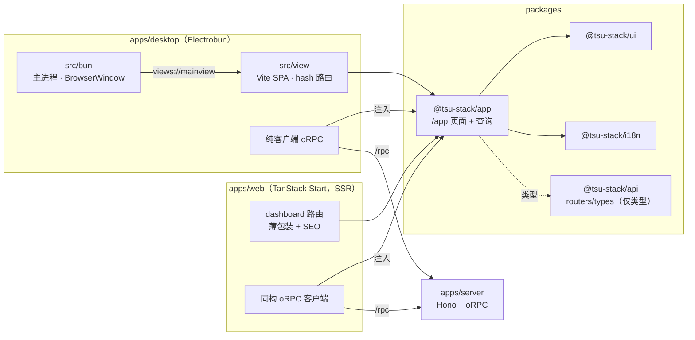
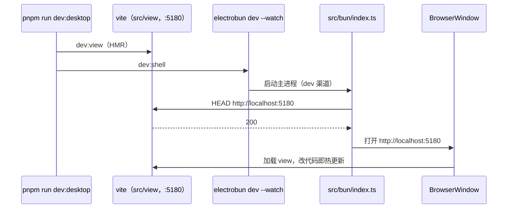

# 【历史归档】桌面端架构计划（方案 B）：共享包 + Electrobun 本地包

> **已被方案 C 替代；历史讨论不代表当前实现。** A、B 未采纳，路线比较仅保留为决策记录。
> 当前入口：[方案 C 实现说明](../../desktop-plan-c-product-app.md) · [方案 C 当前图解](../../show-me-desktop-plan-c-final.html)。

> 状态：历史归档（起草于 2026-10-22，归档于 2026-10-24）。起草时尚未实施；文中的设计与代码片段仅记录当时提案。
> 配套图示：[desktop-architecture-plan.html](./desktop-architecture-plan.html) · 运行时详解：[desktop-architecture-plan-walkthrough.html](./desktop-architecture-plan-walkthrough.html)
> 三条路线对比：[desktop-architecture-options.md](./desktop-architecture-options.md)（本文是其中的方案 B）

## 0. 结论

新增两个工作区项目：

- **`packages/app`（`@tsu-stack/app`，名字暂定）**：放 web 与桌面端共用的 `/app` 界面和数据查询。只依赖 React、TanStack Query、`@tsu-stack/ui`、`@tsu-stack/i18n`，不依赖 TanStack Start 和 Clerk。oRPC 客户端由各应用在启动时注入。
- **`apps/desktop`（`@tsu-stack/desktop`）**：Electrobun 2.x 应用。主进程跑在 Bun 上，窗口加载本地包 `views://mainview`。界面由 Vite 构建的 React SPA 提供（hash 路由），复用 `@tsu-stack/app` 的页面。

web 只做一处结构调整：dashboard 页面的实现搬进共享包，web 保留一层薄包装（路由、SEO、`Container`）。登录不在本计划内，桌面端先显示"登录稍后接入"的占位。

## 1. 目标与范围

| 在范围内                                                   | 不在范围内（后续计划）            |
| ---------------------------------------------------------- | --------------------------------- |
| `apps/desktop` 能在本机开发（HMR）和打包（`build:stable`） | 登录与会话（推荐方向见 §10）      |
| 桌面端界面复用 web 的 `/app` 页面代码                      | 签名、公证、自动更新、CI 构建矩阵 |
| 桌面端能调用 `apps/server` 的公开接口（`health.live`）     | 托盘、通知、菜单等原生能力        |
| web 行为保持不变                                           | 离线数据缓存                      |

## 2. 架构总览



依赖方向只有一条：应用 → `@tsu-stack/app` → `ui` / `i18n` / `api` 的类型。共享包不反向引用任何应用，也不引用 TanStack Start。

## 3. 关键决定

1. **窗口加载本地包。** 生产环境加载 `views://mainview/index.html`；开发时主进程探测到 Vite dev server 就加载它，以便使用 HMR。
2. **复用通过共享包实现，不让 web 产出桌面构建。** 曾比较过两种"把 web 的 `/app` 打包进 `views://`"的做法：
   - 给 web 加一个 Start SPA 构建目标：web 里会到处出现 `if desktop` 分支，而且 Start 只支持浏览器 history。
   - 在 web 里加一个纯 Router 入口：桌面相关的代码会住进 web。

   三种做法需要解开的耦合是同一份，所以选边界最干净的共享包。

3. **共享包不碰 Start 和 Clerk。** 页面不再直接引用 `@tsu-stack/api/client/tanstack-start/orpc`：那个模块含 `createIsomorphicFn`、Clerk 的服务端 `auth()` 和 `appRouter`，离开 Start 编译器会把服务端代码带进浏览器包。共享包改为通过 `configureAppApi({ orpc })` 接收客户端。这沿用了仓库里 `setClerkAuthTokenGetter` 的模块级注入写法，不引入 React Context。
4. **桌面渲染层：Vite + React + TanStack Router，用 hash history 和代码式路由。** `views://` 下的路径是 `/index.html`，刷新深层路由也没有回退，hash history 能同时避开这两个问题。桌面路由很少，代码式路由不需要额外的 router 插件和生成文件。
5. **主进程运行时选 `bun`。** 这是 Electrobun 2.x 的默认值。参考仓库用的 `cottontail` 在官方文档里标为实验性。
6. **桌面端的语言来自设置，不从 URL 判断。** 用 Paraglide 的 `overwriteGetLocale`，现有的 `LocaleProvider` 也是这么做的。messages 直接复用 `@tsu-stack/i18n`。
7. **登录推迟。** 桌面端的 dashboard 先显示占位，oRPC link 留好注入 `Authorization` 的位置（§10）。

## 4. 目录结构

### 4.1 新增 `packages/app`

```text
packages/app/
├── AGENTS.md                         # 共享包约定（参照 packages/db/AGENTS.md 的做法）
├── package.json
├── tsconfig.json
├── styles/
│   └── sources.css                   # @source，让引入方的 Tailwind 扫描包内类名
└── src/
    ├── api/
    │   ├── client.ts                 # configureAppApi() / getAppOrpc()
    │   └── queries/
    │       ├── get-private-data.ts   # useGetPrivateDataQuery + 选项工厂 + key
    │       └── get-health-live.ts    # useGetHealthLiveQuery（桌面首页的 API 状态）
    └── ui/
        └── dashboard/
            └── dashboard-page.tsx    # 从 web 的 dashboard 路由里搬出来的页面主体
```

目录按文件类型分成 `api/`（`.ts`）和 `ui/`（`.tsx`）两块，原因是 `#/` 映射规则：映射不会补扩展名，`.tsx` 目录需要单独一条规则（`packages/ui` 也是这么做的）。每块里面再按业务域分子目录（`dashboard/`、以后的 `projects/` 等）。

`package.json`：

```json
{
  "name": "@tsu-stack/app",
  "private": true,
  "type": "module",
  "imports": {
    "#/ui/*": "./src/ui/*.tsx",
    "#/*": "./src/*.ts"
  },
  "exports": {
    "./api/*": "./src/api/*.ts",
    "./ui/*": "./src/ui/*.tsx",
    "./styles/sources.css": "./styles/sources.css"
  },
  "scripts": {
    "typecheck": "tsc --noEmit"
  },
  "dependencies": {
    "@orpc/tanstack-query": "catalog:",
    "@tanstack/react-query": "catalog:",
    "@tsu-stack/api": "workspace:*",
    "@tsu-stack/i18n": "workspace:*",
    "@tsu-stack/ui": "workspace:*"
  },
  "peerDependencies": {
    "react": "catalog:",
    "react-dom": "catalog:"
  },
  "devDependencies": {
    "@tsu-stack/tsconfig": "workspace:*",
    "@types/react": "catalog:",
    "typescript": "catalog:"
  }
}
```

- 对 `@tsu-stack/api` 只引用 `routers/types`。这个入口本来就是为客户端包设计的，构建时会被完全擦除。
- 以后页面需要站内跳转时再加 `@tanstack/react-router`，并且只用 Router，不引入 Start。

`tsconfig.json`：

```json
{
  "extends": "@tsu-stack/tsconfig/tsconfig.base.json",
  "include": ["**/*.ts", "**/*.tsx"],
  "exclude": ["node_modules"]
}
```

`styles/sources.css`：

```css
/* 引入这个文件的应用会把 @tsu-stack/app 的类名纳入 Tailwind 扫描 */
@source "../src/**/*.{ts,tsx}";
```

`src/api/client.ts`：

```ts
import { type RouterUtils } from "@orpc/tanstack-query";

import { type AppRouterClient } from "@tsu-stack/api/routers/types";

export type AppOrpc = RouterUtils<AppRouterClient>;

let appOrpc: AppOrpc | null = null;

export function configureAppApi(options: { orpc: AppOrpc }) {
  appOrpc = options.orpc;
}

export function getAppOrpc(): AppOrpc {
  if (!appOrpc) {
    throw new Error("@tsu-stack/app: call configureAppApi() before rendering app pages");
  }

  return appOrpc;
}
```

这里保存的是客户端实例，不是用户会话。web 在服务端注入的是同构客户端，它会按每个请求调用 Clerk 的 `auth()` 生成上下文，不会在请求之间串数据。

`src/api/queries/get-private-data.ts`：

```ts
import { useQuery } from "@tanstack/react-query";

import { getAppOrpc } from "#/api/client";

export const privateDataQueryKeys = {
  all() {
    return getAppOrpc().private.data.key();
  }
};

export function getPrivateDataQueryOptions() {
  return getAppOrpc().private.data.queryOptions();
}

export function useGetPrivateDataQuery() {
  return useQuery(getPrivateDataQueryOptions());
}
```

文件名按"目录表明角色"的规则写成 `queries/get-private-data.ts`，不用 `get-private-data.query.ts`。导出的名字沿用 [API fetching patterns](../../../.agents/api-fetching-patterns.md) 的约定。

`src/ui/dashboard/dashboard-page.tsx`：内容就是现在 dashboard 路由里的 `RouteComponent`，只改了两处：数据改用 `useGetPrivateDataQuery()`，最外层的 `<Container>` 换成 Fragment。

```tsx
import { m } from "@tsu-stack/i18n/messages";
import { Spinner } from "@tsu-stack/ui/components/spinner";
import { useIsClient } from "@tsu-stack/ui/hooks/use-is-client.hook";

import { useGetPrivateDataQuery } from "#/api/queries/get-private-data";

export function DashboardPage() {
  const privateData = useGetPrivateDataQuery();
  const isClient = useIsClient();

  return (
    <>
      <h2 className="font-display mb-2 text-4xl">{m.dashboard_page__title()}</h2>
      <section>{/* 状态点与 JSON 输出：原样搬过来 */}</section>
    </>
  );
}
```

`Container` 是 web 自己的布局组件，留在 web 的包装层里，桌面端用自己的布局。

### 4.2 新增 `apps/desktop`

```text
apps/desktop/
├── .gitignore                  # /.hutch/  /build/  /artifacts/
├── electrobun.config.ts        # 应用信息、主进程入口、把 dist/view 复制成 views/mainview
├── hutch.config.ts             # 可选：packageManager: "pnpm"，固定 electrobun 版本（spike 决定）
├── package.json
├── tsconfig.json               # 继承 base + .hutch/devkit/tsconfig.json
├── vite.config.ts              # 构建 view：React、Tailwind、envPrefix DESKTOP_
└── src/
    ├── bun/
    │   └── index.ts            # 主进程：选 URL、开窗口、外链交给系统浏览器
    └── view/
        ├── index.html
        ├── main.tsx            # Vite 入口：挂载 Router + QueryClient
        ├── router.ts           # createRouter + createHashHistory
        ├── routes/
        │   └── tree.ts         # 代码式路由表：/ 与 /dashboard
        ├── shared/
        │   ├── api/orpc.ts     # 纯客户端 RPCLink，调用 configureAppApi
        │   └── i18n/locale.ts  # overwriteGetLocale：语言来自系统或设置
        ├── styles/
        │   └── app.css         # ui globals + app sources + 主题
        └── ui/
            ├── root-layout.tsx       # 桌面外壳：侧栏、标题栏区域
            ├── home-screen.tsx       # 首页：应用信息 + API 状态
            └── dashboard-screen.tsx  # 登录前显示占位，登录后渲染 @tsu-stack/app 的 DashboardPage
```

`package.json`：

```json
{
  "name": "@tsu-stack/desktop",
  "private": true,
  "type": "module",
  "imports": {
    "#/view/ui/*": "./src/view/ui/*.tsx",
    "#/*.css": "./src/*.css",
    "#/*": "./src/*.ts"
  },
  "scripts": {
    "predev": "pnpm --dir ../.. --filter @tsu-stack/i18n run build",
    "dev": "pnpm run \"/^dev:/\"",
    "dev:view": "dotenvx run -f ../../packages/env/.env -- vite",
    "dev:shell": "electrobun dev --watch",
    "prebuild:view": "pnpm --dir ../.. --filter @tsu-stack/i18n run build",
    "build:view": "dotenvx run -f ../../packages/env/.env -- vite build",
    "build:canary": "pnpm run build:view && electrobun build --env=canary",
    "build:stable": "pnpm run build:view && electrobun build --env=stable",
    "typecheck": "electrobun prepare && tsc --noEmit"
  },
  "dependencies": {
    "@orpc/client": "catalog:",
    "@orpc/tanstack-query": "catalog:",
    "@tanstack/react-query": "catalog:",
    "@tanstack/react-router": "catalog:",
    "@tsu-stack/api": "workspace:*",
    "@tsu-stack/app": "workspace:*",
    "@tsu-stack/env": "workspace:*",
    "@tsu-stack/i18n": "workspace:*",
    "@tsu-stack/ui": "workspace:*",
    "react": "catalog:",
    "react-dom": "catalog:"
  },
  "devDependencies": {
    "@dotenvx/dotenvx": "catalog:",
    "@tailwindcss/vite": "catalog:",
    "@tsu-stack/tsconfig": "workspace:*",
    "@types/react": "catalog:",
    "@types/react-dom": "catalog:",
    "@vitejs/plugin-react": "catalog:",
    "electrobun": "catalog:",
    "tailwindcss": "catalog:",
    "typescript": "catalog:",
    "vite": "catalog:"
  }
}
```

- `dev` 用 pnpm 的正则脚本选择同时启动 `dev:view` 和 `dev:shell`，不需要额外引入 `concurrently`。两者的启动顺序在 spike 中确认，主进程侧可以加一个等待 dev server 的重试。
- `typecheck` 先执行 `electrobun prepare`，生成 `.hutch/devkit`。第一次执行需要联网下载 Hutch（见 §8 决策 8）。

`electrobun.config.ts`：

```ts
import { type ElectrobunConfig } from "electrobun";

export default {
  app: {
    name: "TSU Stack",
    identifier: "<你持有的反向域名>.desktop",
    version: "0.0.0"
  },
  runtime: {
    exitOnLastWindowClosed: true
  },
  build: {
    mainProcess: "bun",
    bun: {
      entrypoint: "src/bun/index.ts"
    },
    copy: {
      "dist/view": "views/mainview"
    },
    watchIgnore: ["dist/**"]
    // mac / win / linux 的 bundleCEF 与 defaultRenderer 由 spike 决定（§8 决策 5）
  }
} satisfies ElectrobunConfig;
```

`src/bun/index.ts`（主进程）：

```ts
import { BrowserWindow, Updater } from "electrobun/main";

const DEV_VIEW_URL = "http://localhost:5180";
const PACKAGED_VIEW_URL = "views://mainview/index.html";

async function resolveViewUrl() {
  const channel = await Updater.localInfo.channel();

  if (channel !== "dev") {
    return PACKAGED_VIEW_URL;
  }

  try {
    await fetch(DEV_VIEW_URL, { method: "HEAD" });
    return DEV_VIEW_URL;
  } catch {
    return PACKAGED_VIEW_URL;
  }
}

new BrowserWindow({
  title: "TSU Stack",
  url: await resolveViewUrl(),
  frame: { width: 1280, height: 820, x: 120, y: 120 }
});

// 外链：拦截 http(s) 导航，交给 Utils.openExternal(url)。
// 具体用 navigationRules 还是导航事件，在 spike 中按 Electrobun 2.x 的 API 确认。
```

`vite.config.ts`：

```ts
import { resolve } from "node:path";

import tailwindcss from "@tailwindcss/vite";
import viteReact from "@vitejs/plugin-react";
import { defineConfig } from "vite";

export default defineConfig({
  root: resolve(import.meta.dirname, "src/view"),
  // views:// 下用相对资源路径
  base: "./",
  envDir: resolve(import.meta.dirname, "../../packages/env"),
  // 只把 DESKTOP_ 开头的变量暴露给 view，和 extension 的 WXT_、native 的 EXPO_PUBLIC_ 同理
  envPrefix: "DESKTOP_",
  server: {
    port: 5180,
    strictPort: true
  },
  build: {
    outDir: resolve(import.meta.dirname, "dist/view"),
    emptyOutDir: true
  },
  plugins: [viteReact(), tailwindcss()]
});
```

- 要不要像 web 一样启用 React Compiler（babel 插件），可以在 Phase 2 再决定。
- 只有当 view 需要用 `electrobun/view` 和主进程做 RPC 时（例如 API 改由主进程代发），才需要按官方方式加 `electrobunViteAliases`。它从 `./.hutch/devkit/...` 导入，需要在导入规则里开一个例外，到时再定。

`src/view/shared/api/orpc.ts`：

```ts
import { createORPCClient } from "@orpc/client";
import { RPCLink } from "@orpc/client/fetch";
import { createTanstackQueryUtils } from "@orpc/tanstack-query";
import { QueryClient } from "@tanstack/react-query";

import { type AppRouterClient } from "@tsu-stack/api/routers/types";
import { configureAppApi } from "@tsu-stack/app/api/client";
import { ENV_DESKTOP } from "@tsu-stack/env/desktop/env";

export const queryClient = new QueryClient({
  defaultOptions: {
    queries: {
      retry: 1,
      staleTime: 30_000
    }
  }
});

const link = new RPCLink({
  url: `${ENV_DESKTOP.DESKTOP_SERVER_URL}/rpc`
  // 登录接入后在这里加 headers：Authorization: Bearer <主进程提供的 token>
});

const client: AppRouterClient = createORPCClient(link);

export const orpc = createTanstackQueryUtils(client);

configureAppApi({ orpc });
```

写法和 [extension](../../../apps/extension/utils/orpc.ts)、[native](../../../apps/native/utils/orpc.ts) 的客户端一致。

`src/view/routes/tree.ts`：

```ts
import { createRootRoute, createRoute } from "@tanstack/react-router";

import { DashboardScreen } from "#/view/ui/dashboard-screen";
import { HomeScreen } from "#/view/ui/home-screen";
import { RootLayout } from "#/view/ui/root-layout";

const rootRoute = createRootRoute({ component: RootLayout });

const homeRoute = createRoute({
  getParentRoute: () => rootRoute,
  path: "/",
  component: HomeScreen
});

const dashboardRoute = createRoute({
  getParentRoute: () => rootRoute,
  path: "/dashboard",
  component: DashboardScreen
});

export const routeTree = rootRoute.addChildren([homeRoute, dashboardRoute]);
```

`src/view/styles/app.css`：

```css
@import "@tsu-stack/ui/styles/globals.css";
@import "@tsu-stack/app/styles/sources.css";
@source "../";
/* 主题与字体：见 §8 决策 6 */
```

### 4.3 仓库根视角的变化

```diff
 apps/
+├── desktop/                  # 新增：Electrobun 应用
 ├── extension/
 ├── native/
 ├── server/
 └── web/
     └── src/
+        ├── pages/dashboard/  # 新增：web 侧薄包装（Container + 共享页面）
         └── routes/{-$locale}/(root-layout)/(auth)/dashboard/index.tsx   # 改：引用 pages/dashboard
 packages/
+├── app/                      # 新增：@tsu-stack/app
 ├── api/
 ├── env/
 │   └── src/
+│       └── desktop/env.ts    # 新增：ENV_DESKTOP
 └── …
 docs/
+└── desktop-architecture-plan.md
```

## 5. 对现有代码的改动

| 文件                                                                      | 改动                                                                                                                           | 阶段 |
| ------------------------------------------------------------------------- | ------------------------------------------------------------------------------------------------------------------------------ | ---- |
| `apps/web/src/routes/{-$locale}/(root-layout)/(auth)/dashboard/index.tsx` | 删掉内联的 `RouteComponent`，`component` 改为 `#/pages/dashboard/index` 的 `DashboardPage`；`head()` 保留在 web                | 1    |
| `apps/web/src/pages/dashboard/index.ts`、`ui/dashboard-page.tsx`          | 新增 web 页面切片：`<Container>` 包住 `@tsu-stack/app` 的页面                                                                  | 1    |
| `apps/web/src/router.tsx`                                                 | 模块顶层调用 `configureAppApi({ orpc })`，注入现有的同构客户端                                                                 | 1    |
| `apps/web/src/shared/styles/app.css`                                      | 增加 `@import "@tsu-stack/app/styles/sources.css";`                                                                            | 1    |
| `apps/web/package.json`                                                   | 依赖增加 `"@tsu-stack/app": "workspace:*"`                                                                                     | 1    |
| `packages/env/src/desktop/env.ts`                                         | 新增 `ENV_DESKTOP`（`DESKTOP_SERVER_URL`）                                                                                     | 2    |
| `packages/env/.env.example`                                               | 新增 Desktop 段落                                                                                                              | 2    |
| `pnpm-workspace.yaml`                                                     | catalog 增加 `electrobun: 2.0.4`                                                                                               | 0    |
| 根 `package.json`                                                         | 增加 `dev:desktop`、`build:desktop`                                                                                            | 3    |
| `.oxfmtrc.jsonc`、`.oxlintrc.jsonc`、`.dockerignore`                      | 忽略 `.hutch/`、`artifacts/`，以及 desktop 的 `build/`                                                                         | 3    |
| `.fallowrc.jsonc`                                                         | `entry` 加入 desktop 的主进程、view 入口和两个配置文件                                                                         | 3    |
| `apps/server`                                                             | 代码不变。若 view 直连 API，在 `.env` 的 `CLERK_AUTHORIZED_PARTIES` 加入 `views://mainview` 和开发时的 `http://localhost:5180` | 2    |
| 文档                                                                      | 见下表                                                                                                                         | 3    |

web 侧的三处关键改动：

```diff
 // apps/web/src/routes/{-$locale}/(root-layout)/(auth)/dashboard/index.tsx
-import { useQuery } from "@tanstack/react-query";
 import { createFileRoute } from "@tanstack/react-router";

-import { orpc } from "@tsu-stack/api/client/tanstack-start/orpc";
-import { m } from "@tsu-stack/i18n/messages";
-import { Spinner } from "@tsu-stack/ui/components/spinner";
-import { useIsClient } from "@tsu-stack/ui/hooks/use-is-client.hook";
-
 import { generateAppSeo } from "#/shared/lib/seo";
-import { Container } from "#/shared/ui/container";
+
+import { DashboardPage } from "#/pages/dashboard/index";

 import { appConfig } from "#/config/app.config";

 export const Route = createFileRoute("/{-$locale}/(root-layout)/(auth)/dashboard/")({
   head: ({ params }) => generateAppSeo({ … }),
-  component: RouteComponent
+  component: DashboardPage
 });
-
-function RouteComponent() { … }
```

```ts
// apps/web/src/pages/dashboard/index.ts（新增，和其他 pages 切片的 barrel 一样）
export { DashboardPage } from "./ui/dashboard-page";
```

```tsx
// apps/web/src/pages/dashboard/ui/dashboard-page.tsx（新增）
import { DashboardPage as AppDashboardPage } from "@tsu-stack/app/ui/dashboard/dashboard-page";

import { Container } from "#/shared/ui/container";

export function DashboardPage() {
  return (
    <Container>
      <AppDashboardPage />
    </Container>
  );
}
```

```diff
 // apps/web/src/router.tsx
+import { orpc } from "@tsu-stack/api/client/tanstack-start/orpc";
+import { configureAppApi } from "@tsu-stack/app/api/client";
 import { ENV_WEB_ISOMORPHIC } from "@tsu-stack/env/web/env.isomorphic";
 …
+configureAppApi({ orpc });
+
 export function getRouter() {
```

`packages/env/src/desktop/env.ts`：

```ts
import { createEnv } from "@t3-oss/env-core";
import { z } from "zod";

export const ENV_DESKTOP = createEnv({
  client: {
    DESKTOP_SERVER_URL: z.url()
  },
  clientPrefix: "DESKTOP_",
  emptyStringAsUndefined: true,
  runtimeEnv: import.meta.env
});
```

`.env.example` 新增：

```dotenv
# ============================================================
# 💻 Desktop
# ============================================================

# ✅ required - Public API URL for the desktop app, baked into the view at build time.
DESKTOP_SERVER_URL="http://localhost:5000/server"
```

按 [环境变量规范](../../../.agents/environment-variables.md)，Docker 相关的位置不用改，因为桌面端不进容器。登录接入时再加 `DESKTOP_CLERK_PUBLISHABLE_KEY` 一类的变量，现在不加还没被读取的变量。

文档改动：

| 文档                               | 改动                                                                             |
| ---------------------------------- | -------------------------------------------------------------------------------- |
| `AGENTS.md`                        | Topic Index 加入 `packages/app/AGENTS.md` 和 `.agents/desktop.md`                |
| `.agents/desktop.md`（新增）       | Electrobun 约定：本地包、主进程职责、dev/build 流程、外链策略、API 通道          |
| `packages/app/AGENTS.md`（新增）   | 共享包边界：不引用 Start/Clerk/应用代码；客户端注入；目录按 `api/` 与 `ui/` 划分 |
| `.agents/typescript.md`            | `#/` 映射表加入 `packages/app` 与 `apps/desktop` 两行                            |
| `.agents/toolchain.md`             | Hutch 自带 Bun 运行时这一例外；若需要钉 TS 6，也写在这里（同 `apps/native`）     |
| `.agents/environment-variables.md` | 作用域表加入 `ENV_DESKTOP`                                                       |
| `.agents/api-fetching-patterns.md` | 说明共享包里的查询通过 `getAppOrpc()` 取客户端                                   |
| `.agents/auth.md`                  | 说明桌面端暂未接入登录                                                           |
| `.github/README.md`                | 应用列表、脚本、`DESKTOP_SERVER_URL`                                             |

## 6. 构建与运行流程

开发：



打包：

```text
pnpm run build:desktop
  build:view
    @tsu-stack/i18n build（prebuild:view）
    vite build → apps/desktop/dist/view
  electrobun build --env=stable
    打包主进程（bun）
    copy dist/view → Resources/app/views/mainview
    输出 build/ 与 artifacts/（只能在当前平台构建）
运行
  主进程：channel ≠ dev → views://mainview/index.html
  view：hash 路由，例如 views://mainview/index.html#/dashboard
```

## 7. 分阶段实施

### Phase 0 · Spike（1–2 天，代码可以丢弃）

在 `apps/desktop` 搭一个最小可运行的版本，回答这些问题：

1. Electrobun 2.x 能否在 pnpm 11 + Node 24 + TS 7 下运行 `electrobun dev`？`.hutch/devkit/tsconfig.json` 是否兼容 TS 7？参考仓库需要写 `ignoreDeprecations: "6.0"`。
2. Vite 构建的 view（React + Tailwind v4 + 一个 `@tsu-stack/ui` 组件）在系统 webview 和 CEF 下是否都能正常渲染？
3. hash history 下的路由切换、刷新、前进后退是否正常？
4. view 调用 `health.live` 时实际带的 Origin 头是什么？据此决定 API 通道（§8 决策 4）。
5. `dev:view` 和 `dev:shell` 同时启动时的先后顺序问题。

验收：产出一份决策记录，内容包括 renderer 选择、API 通道、TS 版本、dev 脚本形态。

### Phase 1 · 共享包（1–2 天）

1. 新建 `packages/app`：`package.json`、`tsconfig.json`、`styles/sources.css`、`AGENTS.md`。
2. 写 `api/client.ts`、`api/queries/get-private-data.ts`、`api/queries/get-health-live.ts`。
3. 把 dashboard 页面主体搬到 `ui/dashboard/dashboard-page.tsx`。
4. web：新增 `pages/dashboard` 切片，路由改为引用它；在 `router.tsx` 里注入客户端；`app.css` 引入 sources；补依赖。

验收：web 的 `/dashboard`（含 `/de/dashboard`）行为不变，包括服务端守卫跳转、数据加载、样式。

### Phase 2 · 桌面渲染层与壳（2–3 天）

1. `packages/env` 增加 `ENV_DESKTOP`，同步 `.env.example`。
2. `apps/desktop` 按 §4.2 的结构补齐：`orpc.ts`、`router.ts`、`routes/tree.ts`、`ui/*`、`styles/app.css`、`i18n/locale.ts`。
3. 首页显示应用信息和 API 状态（`useGetHealthLiveQuery`）；dashboard 显示"登录稍后接入"。
4. 主进程：窗口、开发与打包的 URL 切换、外链交给系统浏览器。
5. 主题与字体按决策 6 落地。

验收：`pnpm run dev:desktop` 能热更新；`build:stable` 的产物启动后能看到首页，API 状态显示 Live。

### Phase 3 · 工程化与文档（约 1 天）

1. 根脚本、catalog、各类忽略配置、fallow 入口。
2. 按 §5 的文档表更新。

验收：`pnpm run check` 通过。这一步要等你同意后再运行。

## 8. 待决策

| #   | 问题                                                                         | 推荐                                                                                     | 备选                                                    |
| --- | ---------------------------------------------------------------------------- | ---------------------------------------------------------------------------------------- | ------------------------------------------------------- |
| 1   | 共享包名字                                                                   | `@tsu-stack/app`                                                                         | `@tsu-stack/app-ui`、`@tsu-stack/product`               |
| 2   | 包内目录划分                                                                 | 顶层按 `api/`（ts）与 `ui/`（tsx）分，内部再按业务域分                                   | 按 FSD 分层，需要给每个 tsx 目录写映射规则              |
| 3   | 桌面路由方式                                                                 | 代码式                                                                                   | 文件式（需要 `@tanstack/router-plugin` 和生成的路由树） |
| 4   | view 调 API 的通道                                                           | spike 决定：Origin 正常就直连（服务端放行 `views://mainview`）；是 `null` 就由主进程代发 | 一开始就由主进程代发，以后登录时 token 也留在主进程     |
| 5   | 渲染引擎                                                                     | spike 决定。Tailwind v4 需要 Safari 16.4+，系统 webview 意味着最低 macOS 13.3            | CEF：渲染一致、没有系统版本限制，但包体大很多           |
| 6   | 主题与字体                                                                   | 把 `apps/web/src/shared/styles/theme.css`（以及字体声明）移到 `packages/ui`，两端都引入  | desktop 复制一份                                        |
| 7   | 根 `pnpm run dev` 是否带上 desktop                                           | 带上，与 extension、native 一致                                                          | 只通过 `dev:desktop` 单独启动                           |
| 8   | 根 `check` 和 pre-commit 会跑 desktop 的 `typecheck`，第一次要联网下载 Hutch | 接受                                                                                     | `.hutch/devkit` 不存在时跳过 desktop 的类型检查         |
| 9   | web 是否把 `/dashboard` 迁到 `/app/*`                                        | 暂不迁，不影响本方案                                                                     | 迁移时要同步导航、sitemap、默认跳转                     |

## 9. 风险与待验证

- **Electrobun 2.x 很新（2.0.4）。** 官方文档有前后不一致的地方，例如 `mainProcess` 的默认值，API 也可能变动。所有 API 名称以 spike 实测为准。
- **Hutch 首次运行要联网下载工具链。** CI 需要在 macOS、Windows、Linux 各自的原生 runner 上构建。
- **devkit 的 tsconfig 与 TS 7 可能不兼容。** 不兼容时，desktop 像 `apps/native` 一样单独钉 TS 6。
- **`views://` 请求实际带的 Origin 头未知。** 这决定了 API 通道（决策 4）。
- **模块级注入有顺序要求。** 忘记调用 `configureAppApi` 时，渲染页面会抛出明确的错误，不会悄悄出错。
- **共享包与 web 的 FSD lint。** FSD 规则只作用于 `apps/web/src`，web 通过包名引用共享包，不触发跨切片规则；共享包内部的约定写在 `packages/app/AGENTS.md`。

## 10. 以后（不在本计划内）

- **登录**：推荐在系统浏览器里走 web 的登录页，再用 Clerk OAuth（PKCE）把 token 交给桌面主进程保存。view 的 oRPC link 从主进程取 `Authorization`；服务端 `authenticateRequest` 增加 `acceptsToken: ["session_token", "oauth_token"]`（现在用的 `@clerk/backend` 3.20.1 已支持）。共享包可以在那时再加一个 session 注入点。
- **发布**：`release.baseUrl` 指向静态存储；macOS 签名与公证；canary 和 stable 两个渠道；CI 构建矩阵。
- **原生能力**：应用菜单（macOS 上没有 Edit 菜单时，复制粘贴快捷键可能失效）、托盘、通知（`Utils.showNotification`）、窗口状态记忆。
- **更多共享页面**：`/app` 以后的新页面直接写在 `packages/app`，web 和 desktop 各自加一层路由包装。
