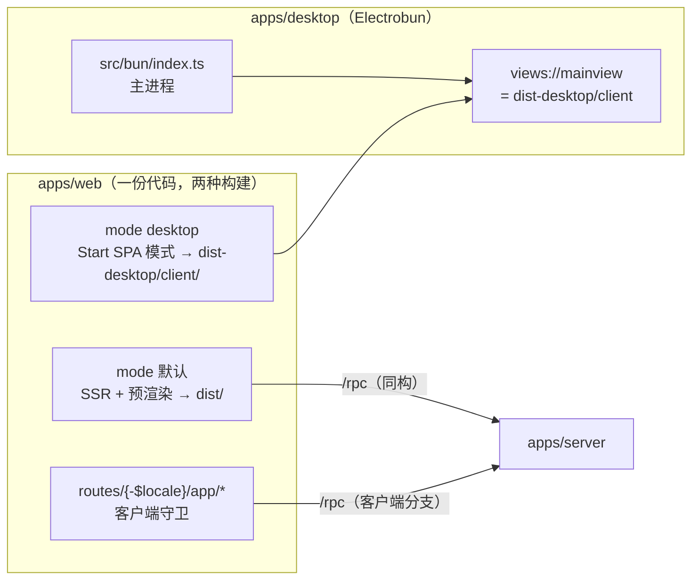

# 【历史归档】方案 A：web 双构建，把 `/app` 打包进 `views://`

> **已被方案 C 替代；历史讨论不代表当前实现。** A、B 未采纳，路线比较仅保留为决策记录。
> 当前入口：[方案 C 实现说明](../../desktop-plan-c-product-app.md) · [方案 C 当前图解](../../show-me-desktop-plan-c-final.html)。

> 状态：历史归档（起草于 2026-10-23，归档于 2026-10-24）。起草时尚未实施；文中的设计与代码片段仅记录当时提案。
> 对比入口：[desktop-architecture-options.md](./desktop-architecture-options.md)

## 0. 结论

不新增共享包，也不新增产品应用。`apps/web` 多一种构建模式 `desktop`：用 TanStack Start 的 SPA 模式产出纯静态文件，`apps/desktop` 把这份产物 `copy` 进 `views://mainview`。产品区放在 web 新增的 `/app` 路由段下，守卫改为客户端判断。

这是三条路线里初次改动最小、首次出窗口最快的一条；代价是产品区永远住在 Start 的构建里，桌面包会带上整个 web。

## 1. 目标与范围

| 在范围内                                               | 不在范围内                     |
| ------------------------------------------------------ | ------------------------------ |
| web 增加 `desktop` 构建模式，产物可直接装进 `views://` | 登录与会话（桌面端先显示占位） |
| web 新增 `/app` 路由段，dashboard 迁入                 | 签名、公证、自动更新、CI 矩阵  |
| `apps/desktop` 能本机开发和打包                        | 托盘、通知、菜单               |
| web 自己的部署行为不变                                 | 离线缓存                       |

## 2. 架构



## 3. 关键决定

1. **产品区是 web 的 `/app` 路由段。** 现有 `(auth)/dashboard` 迁到 `app/dashboard`。`/app` 布局用 `useAuth()` 做客户端守卫，不再调用 `getClerkAuthState()` 这个 server function；`(auth)` 和 `(guest)` 的服务端守卫留给 web 其他页面。
2. **桌面产物来自 Start 的 SPA 模式。** `spa.enabled` 后 Start 只预渲染根路由生成壳，壳文件名改为 `index.html`。`/app` 下所有页面在客户端渲染。
3. **desktop 模式下不注册 `clerkMiddleware()`。** 已核实：预渲染时它会把"未登录"的 Clerk 初始状态写进 HTML，Clerk 读到后会直接返回 `isLoaded: true, isSignedIn: false`，客户端守卫会把已登录用户踢走。
4. **路由只能用 browser history。** Start 的客户端入口不暴露 history 选项。首屏地址是 `views://mainview/index.html`，用 preload 执行 `history.replaceState(null, "", "/app")` 改回应用路径。刷新深层路由能否回到壳，由 spike 决定；不行就在主进程监听导航把窗口重新指回 `index.html`。
5. **`/app` 下禁用 Start 专属 API。** 用 oxlint 的 `no-restricted-imports` 在 `apps/web/src/routes/**/app/**` 和 `apps/web/src/pages/**` 里禁止 `createServerFn`、`@clerk/tanstack-react-start/server`、`@tsu-stack/api/client/tanstack-start/orpc` 的服务端入口。违反只会在桌面运行时 404，所以必须靠 lint 拦。
6. **主进程 `bun`。** 同 B、C。

## 4. 目录结构

### 4.1 `apps/web` 的变化

```diff
 apps/web/
 ├── package.json                   # ~ scripts 增加 build:desktop
 ├── vite.config.ts                 # ~ defineConfig(({ mode }) => …)，desktop 分支见 §5
 ├── dist/                          #   web 自己的 SSR 产物（不变）
+├── dist-desktop/                  # + 桌面产物；.gitignore 加入
+│   └── client/
+│       ├── index.html             #   Start SPA 壳（spa.prerender.outputPath）
+│       └── assets/
 └── src/
     ├── start.ts                   # ~ desktop 模式跳过 clerkMiddleware()
     ├── config/app.config.ts       # ~ basePath 改从 import.meta.env.BASE_URL 取
+    ├── shared/lib/host.ts         # + isDesktopBuild（import.meta.env.MODE === "desktop"）
+    ├── pages/dashboard/           # + 页面切片（从路由文件里抽出）
+    │   ├── index.ts
+    │   └── ui/dashboard-page.tsx
     └── routes/{-$locale}/
         ├── (root-layout)/
-        │   └── (auth)/dashboard/index.tsx     # - 迁走
         │   └── (auth)/                        #   其他需要服务端守卫的页面继续放这里
+        └── app/                               # + 产品区
+            ├── route.tsx                      #   客户端守卫 + 产品外壳
+            └── dashboard/index.tsx            #   head() 留在这里，component 用 pages/dashboard
```

`routes/{-$locale}/app/route.tsx` 的职责：

```text
AppLayout
  useAuth()
    !isLoaded     → <Spinner>
    !isSignedIn   → isDesktopBuild ? <登录占位> : navigate({ to: "/sign-in", search: { redirect } })
    isSignedIn    → <Outlet>（产品外壳：侧栏/顶栏由 widgets/app-shell 提供）
```

### 4.2 新增 `apps/desktop`

```text
apps/desktop/
├── .gitignore                  # /.hutch/  /build/  /artifacts/
├── electrobun.config.ts        # copy "../web/dist-desktop/client" → "views/mainview"
├── hutch.config.ts             # 可选：packageManager "pnpm"
├── package.json                # 只有 Bun 侧依赖：electrobun、typescript
├── tsconfig.json               # base + .hutch/devkit/tsconfig.json，types: bun
└── src/
    └── bun/
        ├── index.ts            # 主进程：选 URL、开窗口、外链交给系统浏览器
        └── preload.ts          # 打包态：history.replaceState(null, "", "/app")
```

这条路线的 `apps/desktop` 没有任何视图代码，和参考仓库一样薄。

### 4.3 仓库根视角

```diff
 apps/
+├── desktop/
 ├── web/
+│   └── dist-desktop/        # 产物，忽略
 …
 packages/env/src/web/env.isomorphic.ts   # 不变：桌面产物复用 VITE_* 变量
```

## 5. 构建模式

`apps/web/vite.config.ts` 的 desktop 分支（草图）：

```ts
export default defineConfig(({ mode }) => {
  const isDesktop = mode === "desktop";

  return {
    base: isDesktop ? "/" : new URL(ENV_WEB_ISOMORPHIC.VITE_WEB_URL).pathname,
    build: isDesktop ? { outDir: "dist-desktop" } : undefined,
    plugins: [
      tanstackStart(
        isDesktop
          ? {
              spa: { enabled: true, prerender: { outputPath: "/index.html" } },
              prerender: { enabled: false }
            }
          : { pages: PAGES_PRERENDER_CONFIG, prerender: { … } }
      ),
      paraglideVitePlugin({ basePath: isDesktop ? "" : webBasePath }),
      …
    ]
  };
});
```

`src/start.ts`：

```ts
requestMiddleware: [
  ...(import.meta.env.MODE === "desktop" ? [] : [clerkMiddleware()]),
  createCsrfMiddleware({ … }),
  tanstackStartRequestLoggerMiddleware({ … })
]
```

`VITE_WEB_URL` 在 desktop 模式下仍然指向真正的网站：登录跳转、`appConfig.site.url` 都需要它。只有"路径前缀"改为从 `import.meta.env.BASE_URL` 取。

## 6. 路由与 `views://`

| 场景             | 地址                             | 结果                                                                    |
| ---------------- | -------------------------------- | ----------------------------------------------------------------------- |
| 打包后首屏       | `views://mainview/index.html`    | preload 改写为 `/app`，路由匹配产品首页                                 |
| 站内跳转         | `views://mainview/app/dashboard` | pushState，正常                                                         |
| 刷新深层路由     | `views://mainview/app/dashboard` | **待 spike**：没有回退则主进程监听导航事件，把窗口重新指回 `index.html` |
| 营销页、guest 页 | 也在包里                         | 主进程导航白名单只放 `/app/*`，其他路径重定向回 `/app`                  |

## 7. i18n 与 Clerk

- i18n 不变：URL 策略在 pushState 下可用，桌面端也能用 `/de/app/...` 切换语言。
- Clerk：产品区继续用 `@clerk/tanstack-react-start` 的 hooks 和 provider。桌面端登录接入时，要在 desktop 模式下处理 provider 对 Start 上下文的依赖（它读 `getGlobalStartContext()`）。这是三条路线里登录口子最窄的一条。

## 8. 对现有代码的改动

| 文件                                                                    | 改动                                                                                                              | 阶段 |
| ----------------------------------------------------------------------- | ----------------------------------------------------------------------------------------------------------------- | ---- |
| `apps/web/vite.config.ts`                                               | desktop 分支：base、outDir、SPA 模式、Paraglide basePath                                                          | 1    |
| `apps/web/src/start.ts`                                                 | desktop 模式跳过 `clerkMiddleware()`                                                                              | 1    |
| `apps/web/src/config/app.config.ts`                                     | `basePath` 改从 `import.meta.env.BASE_URL` 取                                                                     | 1    |
| `apps/web/src/shared/lib/host.ts`                                       | 新增 `isDesktopBuild`                                                                                             | 1    |
| `apps/web/src/routes/{-$locale}/app/*`                                  | 新增产品区与客户端守卫                                                                                            | 1    |
| `apps/web/src/pages/dashboard/*`                                        | 新增页面切片                                                                                                      | 1    |
| `apps/web/src/routes/…/(auth)/dashboard/index.tsx`                      | 删除                                                                                                              | 1    |
| `apps/web/src/features/navbar/config/nav-links.config.ts`               | Dashboard 链接改为 `/app/dashboard`                                                                               | 1    |
| `apps/web/src/features/auth/*`、`(guest)/route.tsx`                     | 登录后默认跳转 `/app`；`redirect` 校验放行 `/app/*`                                                               | 1    |
| `apps/web/package.json`                                                 | `build:desktop` 脚本；`.gitignore` 加 `dist-desktop`                                                              | 1    |
| `.oxlintrc.jsonc`                                                       | `/app` 与 `pages/` 下禁用 Start 专属导入                                                                          | 1    |
| `apps/desktop/*`                                                        | 新增                                                                                                              | 2    |
| `pnpm-workspace.yaml`                                                   | catalog 加 `electrobun`                                                                                           | 0    |
| 根 `package.json`                                                       | `dev:desktop`、`build:desktop`                                                                                    | 3    |
| `.oxfmtrc.jsonc`、`.oxlintrc.jsonc`、`.dockerignore`、`.fallowrc.jsonc` | 忽略 `.hutch/`、`artifacts/`、`build/`、`dist-desktop/`                                                           | 3    |
| 文档                                                                    | `.agents/desktop.md`、`tanstack-patterns.md`（`/app` 的禁用清单）、`toolchain.md`、`auth.md`、`.github/README.md` | 3    |

`apps/server` 代码不变；若桌面直连 API，在 `.env` 的 `CLERK_AUTHORIZED_PARTIES` 加 `views://mainview`。

## 9. 构建与运行

开发：

```text
pnpm run dev:desktop
  apps/web   vite（默认模式，:3000，带 HMR）
  desktop    electrobun dev --watch
  主进程     探测到 :3000 → 窗口打开 http://localhost:3000/web/app
```

开发时窗口里跑的是 SSR 版 web，和打包后的 SPA 壳不是同一种产物。所有 `views://` 相关行为必须用 `build:desktop` 的产物验证。

打包：

```text
pnpm run build:desktop
  apps/web   vite build --mode desktop → dist-desktop/client
  desktop    electrobun build --env=stable
             copy dist-desktop/client → Resources/app/views/mainview
运行
  窗口加载 views://mainview/index.html → preload 改写为 /app
```

## 10. 分阶段实施

| 阶段                  | 内容                                                   | 验收                                                     |
| --------------------- | ------------------------------------------------------ | -------------------------------------------------------- |
| 0 · Spike（1–2 天）   | 同对比文档 §8；额外验证 pushState 刷新行为             | 决策记录                                                 |
| 1 · web（1–2 天）     | `/app` 路由段、客户端守卫、desktop 构建模式、lint 规则 | web 默认构建与行为不变；`build:desktop` 产出可用的静态壳 |
| 2 · 桌面（1 天）      | `apps/desktop` 主进程、preload、copy                   | `build:stable` 启动后看到 `/app` 首页，API 状态 Live     |
| 3 · 工程化（约 1 天） | 根脚本、忽略配置、文档                                 | `pnpm run check` 通过（运行前征得同意）                  |

## 11. 待决策

| #   | 问题                             | 推荐                                                      | 备选                                         |
| --- | -------------------------------- | --------------------------------------------------------- | -------------------------------------------- |
| 1   | 刷新深层路由没有回退时怎么办     | 主进程监听 `will-navigate`，非壳地址重定向回 `index.html` | 产品区内禁用浏览器刷新                       |
| 2   | 桌面包里的营销页怎么处理         | 主进程导航白名单只放 `/app/*`                             | 构建时用 Vite 插件剔除非 `/app` 路由（复杂） |
| 3   | 是否同时保留 `(auth)` 服务端守卫 | 保留给非产品页                                            | 全部改客户端守卫                             |

## 12. 风险

- **`views://` 刷新行为未知，而这条路线只能用 browser history。** 这是 A 独有的风险。
- **SPA 壳带入"未登录"状态。** 已通过"desktop 模式跳过 `clerkMiddleware()`"规避，但要在 spike 里确认壳 HTML 不再包含 `__clerk_init_state`。
- **约定靠 lint 维持。** 任何绕过 lint 的 Start 专属调用都只会在桌面运行时暴露。
- **两份产物进 CI。** web 的 Docker 构建不变，但 `build:desktop` 要单独跑。
- **包体。** 整个 web 都在包里，含字体、MDX 法务页、Start 运行时。
